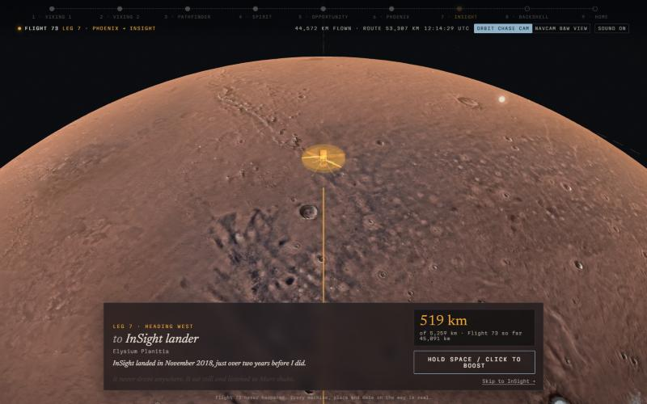

# Still Here: Flight 73

**Ingenuity flew 72 times on Mars. This is the flight it never got to make.**

NASA Space Apps Challenge 2026 · *Abandoned but not Forgotten: Storytelling about NASA's Discarded Equipment on the Moon and Mars*

In January 2024, Ingenuity — the first aircraft on another world — broke its rotor blades on its 72nd flight and never flew again. In *Still Here: Flight 73*, it imagines one more flight: from its resting place in Jezero crater to the NASA landers and rovers whose work on Mars is done, in the order they arrived, and then home. At each stop the machine tells its own story: why it came, what it found, how its last day went and what its work still does today. Then Ingenuity says what it inherited from it.

> Flight 73 never happened. Every machine, place and date on the way is real.



## What makes it different

- **A real machine as the guide.** The narrator is a piece of abandoned NASA hardware, telling the story of the ones that came before it.
- **It starts by failing.** The visitor spins up the real Ingenuity's rotors. They never reach flight speed: the blades damaged on Flight 72 set it shaking, and the rotors wind down. Then a translucent Ingenuity lifts off without it; the real one stays on the sand until the imagined one comes home and settles back into it.
- **The distance is the story.** Nine legs, about 53,000 km across Mars, with real great-circle distances and headings. Ingenuity's 72 real flights covered 17.0 km. Hold Space to boost, or switch to a black-and-white navcam that looks straight down, with live latitude, longitude, heading and Sun height.
- **One hands-on moment at every stop.** Scan Viking 1's first photo from the surface strip by strip, frost Utopia Planitia for Viking 2, roll Sojourner down its ramp, drag Spirit's jammed wheel, thicken the 2018 dust storm over Opportunity, scoop arctic soil and watch snow vaporise above Phoenix, pulse a marsquake under InSight, decode the binary message in Perseverance's parachute, and run Ingenuity's daily wake-up routine.
- **Walk around each site.** Drag to orbit the machine, open numbered story hotspots on the hardware itself, and scrub through the 24 hours of today's sol to watch the light change.
- **Lit like right now.** Mars is lit from the Sun's real direction at this moment. Every stop shows its real local solar time, and its scene is lit by the Sun's real height and direction there (Mars24 algorithm), until the visitor picks another hour.
- **Calls take real light time.** Radio calls from Earth wait on tonight's real Earth–Mars distance; the site card shows how much the app speeds the wait up. Nothing answers.
- **A line of inheritance.** Each stop hands something on — airbag landings, proof of past water, ice under the soil, a map of the deep interior — until it reaches Ingenuity, and from Ingenuity to the helicopters that come next.
- **A postcard home.** The flight log ends with a postcard to one machine, drawn in the browser and saved as an image. Nothing is uploaded.

Screenshots of every part are in [`docs/screenshots/flight-73/`](docs/screenshots/flight-73/).

## Run it

Node.js 24.11 or newer.

```bash
npm install
npm run dev
```

Open <http://localhost:5190/> in a desktop browser with WebGL 2 (Chrome recommended; there is no phone layout). At a site, drag to orbit and scroll to move in or out. During a flight, hold Space to boost. Add `?fps` to the address to show a frame-rate meter. With reduced motion turned on in the operating system, legs and story lines skip their animation.

```bash
npm test
npm run build
```

`npm run build` type-checks and writes a static site to `dist/`. The included GitHub Actions workflow deploys it to GitHub Pages with the right base path.

## How it is built

| Path | What it does |
|---|---|
| `src/types.ts` | Shared data contracts |
| `src/data/machines.ts` | The stops: places, dates, first-person stories, facts and sources |
| `src/data/flight.ts` | Ingenuity's narration: prologue, each leg, inheritance lines, epilogue |
| `src/data/signatures.ts` | The hands-on action at each stop: its control, caption and readout |
| `src/flight/route.ts` | Great-circle legs, distances, headings and the flight timing |
| `src/astro/` | Sun position and local solar time on Mars (Mars24), at any hour of the sol; Earth–Mars distance and light time |
| `src/scene/` | Three.js / React Three Fiber: the globe, the route, the real and the imagined Ingenuity, the site scenes, hotspots and site orbit |
| `src/scene/signatures/` | The scene side of each stop's hands-on action |
| `src/ui/` | Title screen, the full-screen HUD (route bar, site card, stage dock), navcam overlay, radio call, flight log and postcard |
| `docs/FACT_CHECK.md` | Every date and number, with its source |
| `docs/screenshots/flight-73/` | Screenshots of the current version |
| `docs/PLAN-flight-73.md` | The plan this version was built from |

React 19, TypeScript, Three.js, React Three Fiber, drei and Zustand. No accounts, no analytics, no server.

## Accuracy

- Dates, places and numbers come from NASA mission pages. Each one is listed with its source in [`docs/FACT_CHECK.md`](docs/FACT_CHECK.md).
- The flight and the machines' first-person voices are storytelling devices. No quotes are invented.
- Lighting, local time and distances are computed, not looked up; `tests/astro.test.ts` checks them against published reference values and JPL Horizons.
- Resting places known only roughly are marked "approx." in the app.
- The hands-on actions are re-creations in the 3D scene, never NASA imagery. What they show is sourced; what is staged (a ramp's tilt, a cloud's height, a parachute's bit pattern) is listed as illustrative in the fact check.
- The globe uses NASA's Viking colour mosaic and MOLA relief. Machines without a NASA 3D model are drawn as simplified silhouettes and labelled illustrative.

## Development record

This project was started from an empty folder on 14 November 2026 during the Sarawak Space Challenge (NASA Space Apps Challenge 2026). The git history records every step, including the first version (a roll call across the Moon, Mars and deep space) and the move to this Mars-only flight. AI assistance is described in [`AI_USAGE.md`](AI_USAGE.md); credits and licences are in [`CREDITS.md`](CREDITS.md).
